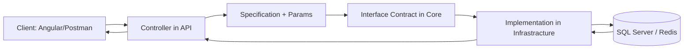

# .NET Web API Controller Guide (Based on Your `skinet-2026` Repository)

> Audience: beginner-friendly (you know basic C# syntax, but want to understand how the layers connect).
>
> Scope: this guide is based on your actual project structure and conventions in `server/`.

---

## 1) What Your Project Actually Looks Like

### Solution/projects

Your backend has **3 projects**:

- `server/API` → Web API app (controllers, middleware, DTOs, startup)
- `server/Core` → domain models + contracts (interfaces/specifications)
- `server/Infrastracture` → implementations (EF Core, Redis, services, migrations)

> Note: folder/project name is spelled **`Infrastracture`** in your repo. Keep that spelling when adding files so paths/namespaces stay consistent.

### Data access approach used

Your project uses:

- **Entity Framework Core** (`Microsoft.EntityFrameworkCore.SqlServer`) for SQL data
- **EF Core Migrations** in `server/Infrastracture/Migrations`
- **Repository + Specification pattern** for many entity queries (`IGenericRepository<T>`, `ISpecification<T>`)
- **Redis** for cart persistence (`StackExchange.Redis`)
- **ASP.NET Core Identity** for auth user store

So this is **not Dapper**. It is EF Core + repository/specification + Identity + Redis.

---

## 2) Folder-by-Folder Explanation (Simple Language)

## Existing folders in your backend

### 2.1 `server/API/Controllers`

**What it is:**
Classes that receive HTTP requests and return HTTP responses.

**Why it exists:**
This is your API entry point from frontend/Postman.

**What belongs here:**
Controller classes with endpoints (`[HttpGet]`, `[HttpPost]`, etc).

**Real examples:**
- `server/API/Controllers/ProductsController.cs`
- `server/API/Controllers/AccountController.cs`
- `server/API/Controllers/CartController.cs`

**Analogy:**
A restaurant counter where customers place orders.

---

### 2.2 `server/API/DTOs`

**What it is:**
Data Transfer Objects (small request/response shapes).

**Why it exists:**
So you don’t expose full database entities directly for every request.

**What belongs here:**
Input/output shapes used by API endpoints.

**Real examples:**
- `server/API/DTOs/RegisterDTO.cs`
- `server/API/DTOs/AddressDTO.cs`
- `server/API/DTOs/CreateProductDTO.cs`

**Analogy:**
A shipping label: only required fields are shown.

---

### 2.3 `server/API/Extensions`

**What it is:**
Helper extension methods.

**Why it exists:**
To avoid repeating common logic (mapping, claims lookups).

**What belongs here:**
Static extension classes.

**Real examples:**
- `server/API/Extensions/AddressMappingExtensions.cs`
- `server/API/Extensions/ClaimsPrincipleExtensions.cs`

**Analogy:**
Reusable kitchen tools used in many recipes.

---

### 2.4 `server/API/Middleware`

**What it is:**
Pipeline components that run for every request.

**Why it exists:**
Centralized cross-cutting behavior (like global exception handling).

**What belongs here:**
Middleware classes.

**Real example:**
- `server/API/Middleware/ExceptionMiddleware.cs`

**Analogy:**
Building security gate that every visitor passes through.

---

### 2.5 `server/API/RequestHelpers`

**What it is:**
Helpers for API response patterns.

**Why it exists:**
Keep pagination and similar wrappers consistent.

**What belongs here:**
Generic response wrappers and helper models.

**Real example:**
- `server/API/RequestHelpers/Pagination.cs`

**Analogy:**
A standard box format for packing different items.

---

### 2.6 `server/Core/Entities`

**What it is:**
Main domain models.

**Why it exists:**
Core business data concepts live here.

**What belongs here:**
`Product`, `AppUser`, `Address`, `ShoppingCart`, etc.

**Real examples:**
- `server/Core/Entities/Product.cs`
- `server/Core/Entities/AppUser.cs`

**Analogy:**
The nouns of your business (Product, User, Address).

---

### 2.7 `server/Core/Interfaces`

**What it is:**
Contracts (“what must be done”), not implementations.

**Why it exists:**
Loose coupling and testability.

**What belongs here:**
Interface definitions for repositories/services/specs.

**Real examples:**
- `server/Core/Interfaces/IGenericRepository.cs`
- `server/Core/Interfaces/ISpecification.cs`
- `server/Core/Interfaces/ICartService.cs`

**Analogy:**
A job description, not the person doing the job.

---

### 2.8 `server/Core/Specifications`

**What it is:**
Reusable query rules (filter/sort/paging logic).

**Why it exists:**
Keeps controller/repository cleaner and query logic composable.

**What belongs here:**
Specification classes + query parameter model.

**Real examples:**
- `server/Core/Specifications/ProductSpecification.cs`
- `server/Core/Specifications/ProductSpecParams.cs`
- `server/Core/Specifications/BaseSpecifications.cs`

**Analogy:**
A search filter template (“only red shoes, sort by price”).

---

### 2.9 `server/Infrastracture/Data`

**What it is:**
Database implementation details.

**Why it exists:**
Contains EF Core context/repositories/spec evaluator/seed logic.

**What belongs here:**
`DbContext`, repository implementations, query evaluators.

**Real examples:**
- `server/Infrastracture/Data/StoreContext.cs`
- `server/Infrastracture/Data/GenericRepository.cs`
- `server/Infrastracture/Data/SpecificationEvaluator.cs`

**Analogy:**
Warehouse operations and inventory systems.

---

### 2.10 `server/Infrastracture/Config`

**What it is:**
EF Core entity configuration classes.

**Why it exists:**
Fluent API configuration is separated from entities.

**What belongs here:**
`IEntityTypeConfiguration<T>` classes.

**Real examples:**
- `server/Infrastracture/Config/ProductConfiguration.cs`
- `server/Infrastracture/Config/DeliveryMethodConfiguration.cs`

**Analogy:**
Rules that define how goods are stored on shelves.

---

### 2.11 `server/Infrastracture/Services`

**What it is:**
Concrete service implementations for external/integration concerns.

**Why it exists:**
Implement interfaces from `Core` using real tech (Redis, Stripe, etc).

**What belongs here:**
Service classes implementing `Core.Interfaces`.

**Real examples:**
- `server/Infrastracture/Services/CartService.cs` (Redis)
- `server/Infrastracture/Services/PaymentService.cs` (Stripe integration in progress)

**Analogy:**
Specialized departments (payment team, cache team).

---

### 2.12 `server/Infrastracture/Migrations`

**What it is:**
EF Core migration history (schema change scripts in C#).

**Why it exists:**
Track and apply DB schema changes consistently.

**What belongs here:**
Migration files and snapshot.

**Real examples:**
- `server/Infrastracture/Migrations/20261020083738_IdentityAdded.cs`
- `server/Infrastracture/Migrations/StoreContextModelSnapshot.cs`

**Analogy:**
Version history for your database structure.

---

### 2.13 `server/API/Program.cs`

**What it is:**
Startup/bootstrap file.

**Why it exists:**
Configures DI, middleware, routing, auth, CORS, data seeding.

**Real example:**
- `server/API/Program.cs`

**Analogy:**
The main control panel that powers and wires the whole building.

---

## Folders/layers that are optional or not primary in your current structure

- Dedicated **application service layer for every feature** (e.g., `Application/Services/ProductService`) is **not the main pattern** here.
  - You use repository + specs directly in controllers for many cases.
- Unit test projects are currently not shown in this repository snapshot.

---

## 3) Trace One Real Controller End-to-End (from your code)

Example: `GET /api/products`

1. Request reaches `ProductsController.GetProducts(...)` in `server/API/Controllers/ProductsController.cs`
2. Controller creates `ProductSpecification` using query params (`ProductSpecParams`)
3. Controller calls `CreatePagedResult(...)` from `BaseApiController`
4. `CreatePagedResult(...)` calls repository methods:
   - `ListAsync(spec)`
   - `CountAsync(spec)`
5. `GenericRepository<T>` uses `SpecificationEvaluator<T>` + EF Core queryable from `StoreContext`
6. SQL Server executes query via EF Core
7. Result is wrapped in `Pagination<T>` and returned to client

This is a real chain from your project.

---

## 4) Dependency Injection (DI) Explained Simply

### Beginner analogy
Think of DI like a **coffee machine in an office**.
- You don’t build a machine every time you want coffee.
- You ask the office system for one.
- The office decides which machine instance to provide.

In code:
- Controller asks for `IGenericRepository<Product>` in constructor.
- ASP.NET Core checks registrations in `Program.cs`.
- It injects `GenericRepository<Product>` automatically.

### Real DI registrations in your `Program.cs`

```csharp
builder.Services.AddScoped<IProductRepository, ProductRepository>();
builder.Services.AddScoped(typeof(IGenericRepository<>), typeof(GenericRepository<>));
builder.Services.AddSingleton<ICartService, CartService>();
builder.Services.AddScoped<IPaymentService, PaymentService>();
```

### Lifetimes

| Method | Lifetime | When to use | Example from your app |
|---|---|---|---|
| `AddScoped` | once per HTTP request | EF Core repositories/services tied to request | `IGenericRepository<>` |
| `AddTransient` | new instance every injection | lightweight stateless helper services | (not primary in current setup) |
| `AddSingleton` | one instance for app lifetime | expensive/shared resources | `ICartService` with Redis multiplexer usage |

### Class vs interface vs constructor vs field vs method

- **Class**: concrete code implementation (`GenericRepository<T>`)
- **Interface**: contract (`IGenericRepository<T>`)
- **Constructor**: where dependencies are requested
- **Private field**: stores dependency inside class
- **Public method**: endpoint or operation users call

---

## 5) Complete Request Flow Diagram



### Example: `GET /api/products/5`

- Client requests product `id=5`
- `ProductsController.GetProductById(5)` calls repository `GetByIdAsync(5)`
- Repository uses EF Core context (`StoreContext`)
- DB returns row or null
- Controller returns:
  - `200 OK` + product if found
  - `404 NotFound` if missing

---

## 6) Step-by-Step Tutorial: Add a New Controller Feature (using your architecture)

## Goal example
Add a simple **Category** API using your existing pattern (Entity + Generic Repository + Controller + optional DTOs).

> This section is an **illustrative example adapted to your architecture**.

---

### Step 1 — Create Entity in `Core`

**Purpose:** define your domain model.

**File:** `server/Core/Entities/Category.cs`

```csharp
namespace Core.Entities
{
    public class Category : BaseEntity
    {
        public required string Name { get; set; } = string.Empty;
        public string? Description { get; set; }
    }
}
```

**Why here:** entities belong to Core so they are shared contracts for API + Infrastructure.

---

### Step 2 — Add DbSet to `StoreContext`

**Purpose:** tell EF Core this table exists.

**File:** `server/Infrastracture/Data/StoreContext.cs`

```csharp
public DbSet<Category> Categories { get; set; }
```

**Important line:** `DbSet<Category>` enables querying and saving categories via EF Core.

---

### Step 3 — (Optional but recommended) Add DTOs for create/update

**Purpose:** control API input shape and validation.

**File:** `server/API/DTOs/CreateCategoryDTO.cs`

```csharp
using System.ComponentModel.DataAnnotations;

namespace API.DTOs
{
    public class CreateCategoryDTO
    {
        [Required]
        public string Name { get; set; } = string.Empty;
        public string? Description { get; set; }
    }
}
```

**Why here:** API-facing contracts should stay in API DTO layer.

---

### Step 4 — Create Controller using your Generic Repository pattern

**Purpose:** expose endpoints.

**File:** `server/API/Controllers/CategoriesController.cs`

```csharp
using API.DTOs;
using Core.Entities;
using Core.Interfaces;
using Microsoft.AspNetCore.Mvc;

namespace API.Controllers;

public class CategoriesController(IGenericRepository<Category> repository) : BaseApiController
{
    [HttpGet]
    public async Task<ActionResult<IReadOnlyList<Category>>> GetCategories()
    {
        return Ok(await repository.ListAllAsync());
    }

    [HttpGet("{id:int}")]
    public async Task<ActionResult<Category>> GetCategory(int id)
    {
        var category = await repository.GetByIdAsync(id);
        if (category == null) return NotFound();

        return category;
    }

    [HttpPost]
    public async Task<ActionResult<Category>> CreateCategory(CreateCategoryDTO dto)
    {
        var category = new Category
        {
            Name = dto.Name,
            Description = dto.Description
        };

        repository.Add(category);

        if (await repository.SaveAllAsync())
            return CreatedAtAction(nameof(GetCategory), new { id = category.Id }, category);

        return BadRequest("[Categories] Problem creating category.");
    }

    [HttpPut("{id:int}")]
    public async Task<ActionResult> UpdateCategory(int id, CreateCategoryDTO dto)
    {
        var category = await repository.GetByIdAsync(id);
        if (category == null) return NotFound();

        category.Name = dto.Name;
        category.Description = dto.Description;

        repository.Update(category);

        if (await repository.SaveAllAsync()) return NoContent();

        return BadRequest("[Categories] Problem updating category.");
    }

    [HttpDelete("{id:int}")]
    public async Task<ActionResult> DeleteCategory(int id)
    {
        var category = await repository.GetByIdAsync(id);
        if (category == null) return NotFound();

        repository.Remove(category);

        if (await repository.SaveAllAsync()) return NoContent();

        return BadRequest("[Categories] Problem deleting category.");
    }
}
```

**How it connects:**
Controller uses `IGenericRepository<Category>` already registered in DI in `Program.cs`.

---

### Step 5 — Dependency registration (usually already done)

In your project this is already present in `server/API/Program.cs`:

```csharp
builder.Services.AddScoped(typeof(IGenericRepository<>), typeof(GenericRepository<>));
```

So no additional DI registration is needed for `Category` specifically.

---

### Step 6 — Add migration and update database

Only needed if schema changes (new entity/table).

Run from `server/`:

```bash
dotnet ef migrations add CategoriesAdded --project Infrastracture --startup-project API
dotnet ef database update --project Infrastracture --startup-project API
```

Why: create table in SQL Server for `Category`.

---

### Step 7 — Test endpoints

Use Postman/Swagger-like client:

- `GET /api/categories`
- `GET /api/categories/1`
- `POST /api/categories`
- `PUT /api/categories/1`
- `DELETE /api/categories/1`

---

### Step 8 — Error handling and response codes

- `200 OK`: successful read
- `201 Created`: successful create
- `204 NoContent`: successful update/delete without body
- `400 BadRequest`: invalid request/business failure
- `404 NotFound`: item missing
- `500`: unhandled exception (formatted by your `ExceptionMiddleware`)

---

## 7) HTTP Endpoint Reference (Practical)

| Endpoint | Purpose | Request Example | Success Response | Common Error Codes |
|---|---|---|---|---|
| `GET /api/products` | list resources | query params: `?pageIndex=1&pageSize=6&search=boot` | `200` paged object | `400`, `500` |
| `GET /api/products/{id}` | get one resource | `GET /api/products/10` | `200` + object | `404`, `500` |
| `POST /api/products` | create | JSON body | `201` + created object | `400`, `500` |
| `PUT /api/products/{id}` | full update | JSON body | `204` | `400`, `404`, `500` |
| `PATCH /api/products/{id}` | partial update | not currently implemented in your repo | usually `200/204` | `400`, `404` |
| `DELETE /api/products/{id}` | delete | route id | `204` | `404`, `500` |

### Example request/response JSON

**POST /api/products**

```json
{
  "name": "Starter Board",
  "description": "Good for beginners",
  "price": 99.99,
  "pictureUrl": "/images/products/board.png",
  "type": "Boards",
  "brand": "Angular",
  "quantityInStock": 10
}
```

**201 Created response**

```json
{
  "id": 123,
  "name": "Starter Board",
  "description": "Good for beginners",
  "price": 99.99,
  "pictureUrl": "/images/products/board.png",
  "type": "Boards",
  "brand": "Angular",
  "quantityInStock": 10
}
```

---

## 8) Common Beginner Mistakes (and fixes)

### 1) Service/repository not registered in DI
- **Symptom:** “Unable to resolve service…”
- **Cause:** missing `builder.Services.Add...` in `Program.cs`
- **Fix:** register interface-to-implementation pair.

### 2) Wrong namespace/library (EF6 vs EF Core)
- **Symptom:** `IDbAsyncQueryProvider` error
- **Cause:** `using System.Data.Entity` in EF Core app
- **Fix:** use `Microsoft.EntityFrameworkCore` async extensions.

### 3) Wrong project/folder placement
- **Symptom:** architectural confusion or circular dependencies
- **Cause:** putting Infra code in API or vice versa
- **Fix:** keep contracts in Core, implementations in Infrastracture, HTTP in API.

### 4) Connection string mismatch
- **Symptom:** DB connect/login failure
- **Fix:** verify `DefaultConnection` in `server/API/appsettings.Development.json`.

### 5) Forgot migration after entity change
- **Symptom:** runtime SQL errors/table missing
- **Fix:** add migration + update DB.

### 6) Incorrect HTTP status usage
- **Symptom:** client logic breaks
- **Fix:** use semantically correct status (`404` missing, `201` created, etc).

### 7) Mixing Entity and DTO carelessly
- **Symptom:** over-posting or leaking fields
- **Fix:** use DTOs for inbound/outbound API contracts when needed.

### 8) Too much logic in controllers
- **Symptom:** huge controller methods
- **Fix:** move query complexity into specifications/repositories/services.

### 9) Sync DB calls in async pipeline
- **Symptom:** lower scalability
- **Fix:** prefer `await ...Async()` methods.

### 10) Exposing sensitive error details in production
- **Symptom:** security risk
- **Fix:** your middleware already returns less detail outside development.

---

## 9) Practical Checklist (Reuse This Every New Feature)

- [ ] Define feature scope and endpoint list first.
- [ ] Create/extend entity in `Core/Entities` if needed.
- [ ] Create DTOs in `API/DTOs` for request/response shapes.
- [ ] Add `DbSet<T>` in `StoreContext` when table is needed.
- [ ] Reuse `IGenericRepository<T>` or create a new interface only when truly needed.
- [ ] Keep filtering/sorting/paging in Specification classes when query gets complex.
- [ ] Create controller in `API/Controllers` inheriting `BaseApiController`.
- [ ] Return proper status codes (`200/201/204/400/404`).
- [ ] Register dependencies in `Program.cs` (if new service/repository required).
- [ ] Add migration + update DB for schema changes.
- [ ] Test all endpoints (success + failure cases).
- [ ] Validate model input via data annotations / model state.
- [ ] Confirm exceptions are handled by `ExceptionMiddleware`.
- [ ] Verify CORS/auth behavior for frontend calls.

---

## 10) Real files you should keep open while learning

- `server/API/Program.cs`
- `server/API/Controllers/BaseApiController.cs`
- `server/API/Controllers/ProductsController.cs`
- `server/API/Controllers/AccountController.cs`
- `server/Core/Interfaces/IGenericRepository.cs`
- `server/Core/Interfaces/ISpecification.cs`
- `server/Core/Specifications/ProductSpecification.cs`
- `server/Infrastracture/Data/GenericRepository.cs`
- `server/Infrastracture/Data/StoreContext.cs`
- `server/API/Middleware/ExceptionMiddleware.cs`

These are your best “how this app works” map.

---

## 11) Final note

Your project currently combines:
- Repository + Specification for product-style data querying
- Identity endpoint mapping (`MapIdentityApi<AppUser>()`)
- Redis cart service

So when adding new features, follow existing conventions first, then add complexity only if needed.
